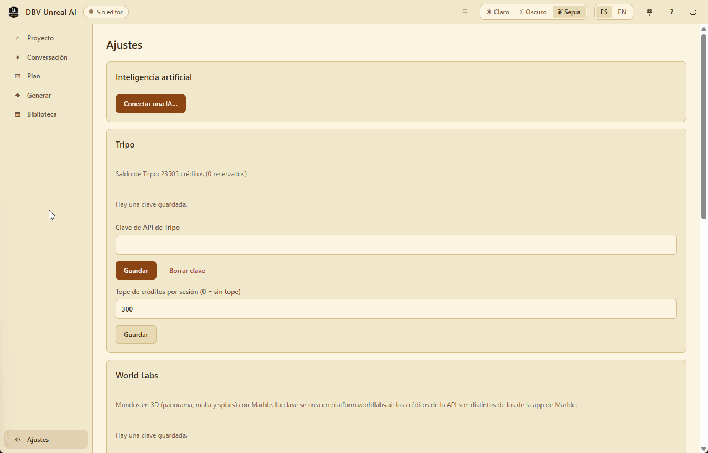

<p align="center"></p>

# DBV Unreal AI

**🇪🇸 Español · [🇬🇧 English](./README.en.md)**

[](https://davidbuenov.github.io/dbv-unreal-ai/)
[](https://github.com/davidbuenov/dbv-unreal-ai/releases)
[](https://apps.microsoft.com/detail/9n5ls7zkgth5?hl=es-ES&gl=ES)
[](https://github.com/davidbuenov/dbv-unreal-ai/releases/tag/v0.2.3)
[](./LICENSE)
[-0078D7?style=flat&logo=windows&logoColor=white)](https://apps.microsoft.com/detail/9n5ls7zkgth5?hl=es-ES&gl=ES)
[-000000?style=flat&logo=apple&logoColor=white)](https://github.com/davidbuenov/dbv-unreal-ai/releases/latest)
[](https://github.com/davidbuenov/dbv-unreal-ai/releases/latest)
[](https://www.rust-lang.org)
[](https://v2.tauri.app)
[](https://www.unrealengine.com)
[](https://www.worldlabs.ai)
[](https://www.tripo3d.ai)
[](https://www.python.org)
[](https://threejs.org)
[](https://github.com/davidbuenov/dbv-specs-ops)

> Copiloto de IA nativo para Unreal Engine 5.8: conecta cualquier IA (local o en la nube) a tu proyecto abierto, lo prepara si hace falta y genera assets con Tripo y World Labs directamente en el editor.
>
> 🌐 **Sitio web oficial:** https://davidbuenov.github.io/dbv-unreal-ai/

## 📑 Índice

- [Descárgalo e instálalo](#install)
  - [Microsoft Store (Windows)](#install-msstore)
  - [Windows (Releases)](#install-windows)
  - [macOS](#install-macos)
  - [Linux](#install-linux)
  - [Próximamente: Homebrew y Uptodown](#install-soon)
- [Sobre el proyecto](#about)
- [Aplicaciones compatibles y ecosistema](#ecosystem)
- [Estado](#status)
- [Cómo funciona](#how)
- [Requisitos](#requirements)
- [Para desarrolladores](#usage)
- [Usarlo desde otros agentes (MCP)](#mcp)
- [Qué IA usar](./docs/IA.md)
- [Tests](#tests)
- [Estructura del proyecto](#structure)
- [Changelog](#changelog)
- [Licencia](#license)

---

<a name="install"></a>

## 🚀 Descárgalo e instálalo

**No necesitas Rust, Node.js ni ninguna herramienta de programación.** Descarga el instalador de tu sistema desde la **[última Release de GitHub](https://github.com/davidbuenov/dbv-unreal-ai/releases/latest)**: se compila automáticamente en cada versión para Windows, macOS (Intel y Apple Silicon) y Linux.

Solo necesitas **Unreal Engine 5.8** para trabajar con un proyecto y, si quieres conversar, una IA (local, con clave de API o tu suscripción): la guía [`docs/IA.md`](./docs/IA.md) explica cada opción. Las claves de [Tripo](https://www.tripo3d.ai) y [World Labs](https://platform.worldlabs.ai) son opcionales y solo hacen falta para generar modelos y mundos 3D.

> **Actualizaciones:** la app todavía no se actualiza sola. Para pasar a una versión nueva, descarga e instala el instalador nuevo desde Releases; la biblioteca, las conexiones y las claves se conservan.

<a name="install-msstore"></a>

### 🛒 Microsoft Store (Windows - Oficial y Recomendado)

Ya puedes instalar **DBV Unreal AI** de forma gratuita directamente desde la Microsoft Store, con paquete firmado oficialmente por Microsoft, sin advertencias de SmartScreen y con actualizaciones automáticas:

<p align="center">
  <a href="https://apps.microsoft.com/detail/9n5ls7zkgth5?hl=es-ES&gl=ES" target="_blank">
    
  </a>
</p>

- 🇪🇸 **Español:** [DBV Unreal AI: descarga e instalación gratuitas en Windows | Microsoft Store](https://apps.microsoft.com/detail/9n5ls7zkgth5?hl=es-ES&gl=ES)
- 🇬🇧 **English:** [dbv-unreal-ai - Free download and install on Windows | Microsoft Store](https://apps.microsoft.com/detail/9n5ls7zkgth5?hl=en-EN&gl=EN)

<a name="install-windows"></a>

### 🪟 Windows (Instaladores manuales desde Releases)

Si prefieres no usar la tienda, **[⬇️ Descarga desde Releases](https://github.com/davidbuenov/dbv-unreal-ai/releases/latest)** uno de estos dos (Windows 10 y 11, 64 bits):

- **`DBV.Unreal.AI_x.y.z_x64-setup.exe`** — el recomendado: doble clic y listo.
- **`DBV.Unreal.AI_x.y.z_x64_en-US.msi`** — el mismo programa en formato MSI, pensado para instalaciones gestionadas (empresas, aulas).

El instalador no está firmado con un certificado de código, así que la primera vez Windows SmartScreen avisa de que «Windows protegió su PC». Pulsa **Más información → Ejecutar de todas formas**. El motor de la interfaz (WebView2) ya viene con Windows 10 y 11; si faltara, el instalador lo descarga.

<a name="install-macos"></a>

### 🍎 macOS

**[⬇️ Descarga `DBV.Unreal.AI_x.y.z_universal.dmg` desde Releases](https://github.com/davidbuenov/dbv-unreal-ai/releases/latest)** — un único binario universal para Intel y Apple Silicon. Ábrelo y arrastra **DBV Unreal AI** a **Aplicaciones**.

No está firmado ni notarizado (requiere el Apple Developer Program, de pago), así que macOS lo bloquea la primera vez («no se puede abrir porque su desarrollador no puede verificarse»). Para abrirlo:

- Clic derecho (o `Ctrl` + clic) sobre **DBV Unreal AI** en Aplicaciones → **Abrir** → confirma en el diálogo. Solo hace falta la primera vez.
- O, desde la Terminal: `xattr -cr "/Applications/DBV Unreal AI.app"` antes de abrirlo.

El fichero `DBV.Unreal.AI_universal.app.tar.gz` de la Release es la misma app comprimida; para instalar basta con el `.dmg`.

<a name="install-linux"></a>

### 🐧 Linux

**[⬇️ Descarga desde Releases](https://github.com/davidbuenov/dbv-unreal-ai/releases/latest)** el paquete de tu distribución (x86_64):

- **`.deb` (Debian, Ubuntu, Linux Mint y derivadas):** `sudo apt install ./DBV.Unreal.AI_x.y.z_amd64.deb` (o doble clic desde el gestor de archivos). Instala también las dependencias que falten, como WebKitGTK.
- **`.rpm` (Fedora, openSUSE, RHEL y derivadas):** `sudo dnf install ./DBV.Unreal.AI-x.y.z-1.x86_64.rpm` (en openSUSE, `sudo zypper install`).
- **`.AppImage` (cualquier distribución):** dale permisos de ejecución (`chmod +x DBV.Unreal.AI_x.y.z_amd64.AppImage`) y ejecútalo. Es portátil, no necesita instalación.

<a name="install-soon"></a>

### 🔜 Próximamente

Estos canales aún no están disponibles; llegarán en una próxima versión. Mientras tanto, usa la Microsoft Store o los instaladores de Releases de arriba.

- **🍺 Homebrew (macOS):** `brew install --cask` desde un tap propio que se actualice solo con cada Release.
- **🟢 Uptodown:** descarga directa de la última versión para Windows y macOS.

---

<a name="about"></a>

## 📌 Sobre el proyecto

**DBV Unreal AI** (`dbv-unreal-ai`) es una aplicación de escritorio nativa (Windows, macOS y Linux) que conversa contigo y actúa sobre el proyecto de Unreal Engine 5.8 que tengas abierto. Usa la IA que prefieras —un modelo local (Ollama, LM Studio), una API en la nube o tu suscripción de Claude Code, Codex o Copilot (Gemini CLI, con acceso de pago)— y la conecta con el editor a través de su servidor MCP integrado. Si el proyecto aún no está preparado, la aplicación lo prepara por ti. Genera modelos 3D con Tripo y mundos fotorrealistas con World Labs Marble, los guarda en una biblioteca local y los lleva al editor con un clic.

**Construido con:** Rust, Tauri v2, HTML/CSS/JavaScript sin bundler, Unreal Engine 5.8 (MCP + Python + C++).

---

<a name="ecosystem"></a>

## 🔗 Aplicaciones compatibles y ecosistema conectado

**DBV Unreal AI** actúa como puente nativo y centro de control entre tu entorno de desarrollo y los principales estándares de generación espacial y modelado 3D por IA:

| Icono | Aplicación / Plataforma | Tipo de Conexión en DBV Unreal AI | Capacidades integradas |
| :---: | :--- | :--- | :--- |
| <a href="https://www.unrealengine.com"></a> | **[Unreal Engine 5.8](https://www.unrealengine.com)** | **Nativa (Local)**<br>MCP HTTP en puerto 8000+ & Python/C++ | • Conexión bidireccional y auto-diagnóstico del editor en tiempo real.<br>• Validación estática de Python con diff y aprobación previa obligatoria.<br>• Componente nativo C++ libre `UDbvGaussianSplatComponent` para 3DGS.<br>• Soporte multi-instancia y reversión de transacciones por turno en 1 clic. |
| <a href="https://www.worldlabs.ai"></a> | **[World Labs (Marble)](https://www.worldlabs.ai)** | **API Cloud / Llavero seguro**<br>Key en almacén de credenciales del SO | • Generación de mundos fotorrealistas persistentes con modelos `marble-1.1`.<br>• Descarga de Gaussian Splats (`.spz`) y mallas físicas con colisión (`.glb`).<br>• Inspección previa en visor 3D local con Three.js.<br>• Botón «Enviar a Unreal» para colocación instantánea sincronizada. |
| <a href="https://www.tripo3d.ai"></a> | **[Tripo3D](https://www.tripo3d.ai)** | **API Cloud / Llavero seguro**<br>Superficie completa de 18 operaciones | • Generación de mallas 3D desde descripciones de texto o imágenes.<br>• Saldo visible de créditos y optimización poligonal inteligente.<br>• Auto-rigging esquelético y aplicación de clips de animación dinámicos.<br>• Importación directa como Static Mesh, Skeletal Mesh y Animation Sequence. |

---

<a name="status"></a>

## 🚧 Estado

**v0.2.3** (2026-10-29). La conexión a IAs y su guía pasan a ser las mismas de todas las apps DBV ([`dbv-tauri-starter`](https://github.com/davidbuenov/dbv-tauri-starter), donde se probaron agente por agente):

- **Todos los agentes por suscripción funcionan (REQ-49):** Google Antigravity con su servidor oficial `agy_acp_server` e inicio de sesión con tu cuenta de Google, Codex con el adaptador actual (adiós al «Internal error»), GitHub Copilot distinguiendo su CLI del lanzador de VS Code, y Claude Code;
- **Guía de IAs completa dentro de la app (REQ-48):** en `F1` → *Guía de IAs* y desde «Conectar una IA», sin conexión y con botón *Copiar* para cada orden de instalación; es la misma que [`docs/IA.md`](./docs/IA.md).

<p align="center"></p>

**v0.2.1** (2026-10-28). Versión menor centrada en usabilidad, claridad de conexión a IAs, ayuda integrada y preparación para tiendas:

- **Clasificación clara en «Conectar una IA» (REQ-43):** tres categorías semánticas jerarquizadas (IAs Locales 100% offline, IAs por Suscripción mediante agentes CLI e IAs en la nube con API key) con distintivos de estado dinámicos en vivo (`✓ Activa` / `✓ Conectada`);
- **Soporte oficial de Google Antigravity CLI (REQ-44):** integración de `agy` para suscripciones Pro, Plus y Google One / Gemini Advanced sin claves de API;
- **Centro de Ayuda integrado (REQ-46):** acceso rápido desde la cabecera (?) o con el atajo global **`F1`**, con guías de Unreal Engine 5.8, tabla comparativa de IAs y atajos;
- **Modal «Acerca de» renovado (REQ-45):** ficha técnica de entorno, enlaces de proyecto y telemetría de plataforma con el diseño refinado de DBV Typst Editor;
- **Empaquetado para Microsoft Store:** configuración MSIX completa con `@choochmeque/tauri-windows-bundle` y verificación de assets anti-placeholder;
- **Generación de mundos fotorrealistas con World Labs Marble (REQ-18):** generación desde texto o imagen (`marble-1.1`), cálculo de créditos, descarga automática de splats gaussianos `.spz`, mallas físicas `.glb` y metadatos de escala a la biblioteca;
- **Componente nativo C++ de 3D Gaussian Splatting (REQ-41, REQ-42):** módulo `DBVUnrealAICpp` con `UDbvGaussianSplatComponent` y colocación sincronizada de splats `.spz` y mallas en el nivel mediante «Enviar a Unreal»;
- **Deshacer turno con un clic (REQ-40):** botón «↩️ Deshacer este turno» en la conversación que revierte en bloque las transacciones en Unreal Engine vía Slate post-tick callback;
- **Múltiples instancias de Unreal (REQ-07):** detección y gestión de editores concurrentes en puertos contiguos (8000, 8001…) con verificación de identidad y selector dinámico;
- **Selector y acoplamiento interactivo de personajes en animaciones (REQ-16, REQ-31):** el visor 3D enlaza en tiempo real los tracks de animación del clip seleccionado al rig de cualquier personaje de la biblioteca;
- **Memoria persistente y planificación interactiva (REQ-34..REQ-37):** gestión de `dbv-unreal-ai/memory.md` y `task.md` con comprobación de criterios de «hecho» en el editor y vista interactiva Plan;
- **Captura visual del viewport (REQ-13):** `unreal_capture_viewport` para modelos multimodales con rejilla en metros y etiquetado;
- **Tripo verificado en vivo (REQ-15, REQ-16):** modelos, rigs y animaciones comprobados contra la API real de Tripo y colocados en el editor como Skeletal Mesh y Animation Sequence;
- conexión con el editor por MCP, diagnóstico y preparación del proyecto con diff y «Revertir»;
- conversación con IA local, en la nube o agentes de suscripción, con aprobación explícita de modificaciones y validación previa de Python;
- servidor MCP propio (`dbv-unreal-ai --mcp`) para usar todas las herramientas desde agentes externos.

Hoja de ruta en [`SPECIFICATIONS.md`](./dbv-specs-ops/docs/SPECIFICATIONS.md).

---

<a name="how"></a>

## 🧭 Cómo funciona

1. **Proyecto.** La app detecta los editores de Unreal abiertos y se conecta sola al servidor MCP del editor (`127.0.0.1:8000/mcp`). Si al proyecto le falta algo, el diagnóstico lo dice punto por punto.
2. **Preparar.** «Preparar proyecto…» enseña el diff de cada fichero antes de tocarlo y guarda una copia de seguridad: activa los plugins `ModelContextProtocol`, `ToolsetRegistry`, `PythonScriptPlugin`, `EditorToolset`, `AutomationTestToolset` y `SlateInspectorToolset`, enciende el arranque automático del servidor MCP e instala el **toolset de DBV Unreal AI** (un plugin de solo contenido en Python: no hay que compilar). Con el editor cerrado; al abrirlo de nuevo, queda conectado.
3. **Conversación.** La IA descubre las herramientas del editor (más de 280 en un proyecto preparado), consulta la escena y actúa. Las consultas se ejecutan solas; lo que modifica el proyecto aparece en una tarjeta con el detalle completo y espera tu «Permitir». El Python se valida antes contra la API real de tu versión del motor: si usa algo que no existe o está obsoleto, la IA lo corrige sin molestarte. Todo queda en el registro de acciones (exportable a Markdown).
4. **Generar.** Describe un objeto o elige una imagen de referencia, pide de 1 a 4 variantes y acepta el coste: la tarjeta da el total según la tabla de precios de Tripo y enseña exactamente lo que se envía. Cada trabajo tiene su consola y su progreso; el modelo se descarga a la biblioteca.
5. **Biblioteca.** Cada asset dice qué es y de cuál sale. Un modelo se puede **riggear**, un rig se puede **animar** (hasta 5 animaciones de una vez) y todo se ve en 3D. «Enviar a Unreal» lo importa en `/Game/DBV/Generated` con su material y textura y lo coloca delante de la cámara, en la carpeta `DBV/Generated` del Outliner; un personaje llega como Skeletal Mesh moviéndose. Puedes importar tus propios modelos y elegir dónde vive la biblioteca.

---

<a name="requirements"></a>

## 🧰 Requisitos

- **Unreal Engine 5.8** (instalado con el launcher de Epic o compilado).
- Para desarrollar (no hace falta para usar los instaladores de [Releases](#install)): [Rust](https://rustup.rs) (stable), Node.js 20+ y las dependencias de sistema de Tauri v2 (WebView2 en Windows, WebKitGTK en Linux). Python 3.10+ para los tests del toolset.
- Opcional: una IA (Ollama/LM Studio, una clave de API o un agente de suscripción) y una clave de API de [Tripo](https://www.tripo3d.ai) para generar modelos. Las claves se guardan en el almacén de credenciales del sistema, nunca en ficheros.

---

<a name="usage"></a>

## 🧑‍💻 Para desarrolladores

Para ejecutar la app desde el código fuente (si solo quieres usarla, mejor el [instalador](#install)):

```bash
npm install
npm run tauri dev
```

Instaladores (en `src-tauri/target/release/bundle/`):

```bash
npm run tauri build
```

Al subir un tag `vX.Y.Z`, GitHub Actions compila Windows, macOS (universal) y Linux y los adjunta a una Release en borrador, que se publica a mano.

---

¿Qué IA conectar (local, con clave de API o tu suscripción) y qué necesitas para cada una? Lo explica la guía [`docs/IA.md`](./docs/IA.md).

---

<a name="mcp"></a>

## 🔌 Usarlo desde otros agentes (MCP)

El propio ejecutable es un servidor MCP por stdio (sin puerto de red). En Claude Code, Cursor o Gemini CLI:

```json
{
  "mcpServers": {
    "dbv-unreal-ai": { "command": "<ruta>/dbv-unreal-ai", "args": ["--mcp", "--port", "8000"] }
  }
}
```

La vista **Ajustes** te da este bloque con la ruta exacta. Ofrece el puente al editor (con la validación del Python), la biblioteca (listar, importar, renombrar, «Enviar a Unreal») y **toda la API de Tripo**: `generate_3d_model`, `image_to_3d_model`, `rig_model`, `animate_model`, `tripo_run` (cualquier otra operación), `tripo_operations` (catálogo con precios), `tripo_balance` y `generation_jobs`. Lo que cuesta créditos exige `confirm_cost: true` tras decirle el precio al usuario; los trabajos corren en segundo plano y la app enseña su progreso.

---

<a name="tests"></a>

## 🧪 Tests

```bash
npm run test:all     # Rust + Vitest + toolset Python + linter
npm run test:e2e     # interfaz en Edge headless (el motor de WebView2), con el backend simulado
```

Contra un editor real abierto (solo lectura): `DBV_UNREAL_MCP_PORT=8000 cargo test --manifest-path src-tauri/Cargo.toml --lib -- --ignored en_vivo`.

---

<a name="structure"></a>

## 📂 Estructura del proyecto

```text
/
├── src/                     # Interfaz (HTML/CSS/JS sin bundler)
│   ├── app/                 #   vistas: Proyecto, Generar, Biblioteca, Ajustes, registro
│   ├── unreal/              #   herramientas de Unreal para la IA, permisos, tarjeta de aprobación, envío
│   ├── generation/          #   herramientas de generación y biblioteca para la IA
│   └── ai/                  #   asistente de IA de tres niveles (de dbv-tauri-starter)
├── src-tauri/src/           # Backend en Rust
│   ├── unreal/              #   descubrimiento, cliente MCP del editor, preparación
│   ├── generation/          #   cliente de Tripo v3 y trabajos de generación
│   ├── library/             #   biblioteca local de assets
│   ├── mcp_server.rs        #   servidor MCP propio (--mcp)
│   └── ai/                  #   proveedores, ACP, llavero del sistema
├── unreal-plugin/           # Toolset que se instala en el proyecto (Python; plantilla C++)
├── tests/                   # Vitest, tests del toolset en Python y respuestas reales del editor
├── scripts/e2e/             # Banco de interfaz
└── dbv-specs-ops/           # Especificaciones, arquitectura, task.md, memory.md y CHANGELOG.md
```

---

<a name="changelog"></a>

## 📋 Changelog

Ver [CHANGELOG.md](./dbv-specs-ops/CHANGELOG.md).

Las notas de cada versión están en dos ficheros, [`dbv-specs-ops/releases/vX.Y.Z.md`](./dbv-specs-ops/releases/) (español) y `vX.Y.Z.en.md` (inglés), y la Release de GitHub las lleva las dos.

---

<a name="license"></a>

## 📄 Licencia

MIT — ver [LICENSE](./LICENSE).

Copyright (c) 2026 David Bueno Vallejo y David Bueno Carmona

---

> 🛠️ Construido con **[dbv-specs-ops](https://github.com/davidbuenov/dbv-specs-ops)** — el framework SDD para desarrollo asistido por IA.
> Creado por [David Bueno Vallejo](https://github.com/davidbuenov) — libre y gratuito.
